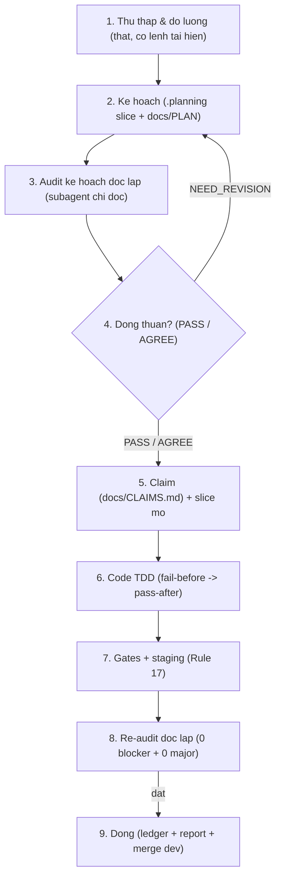

# workflow-dev-loop — Vòng kín chuẩn (hiệu chỉnh cho vninvestcharts-widget)

> **Nguồn gốc:** học từ `erp-dev-loop` của ERP-Edusuccess (vòng 9 bước), hiệu chỉnh cho repo chart này.
> **Nguyên tắc vàng:** file của repo đang làm việc (`AGENTS.md`, `CLAUDE.md`,
> `docs/upgrade-standard/AGENT_PROTOCOL.md`, `docs/CLAIMS.md`) **luôn thắng** khi xung đột với skill này.

## 0. Kích hoạt mặc định

Mọi nhiệm vụ liên quan code (thêm tính năng, sửa lỗi, refactor, test, audit có sửa code, mở PR,
chạy solo hay song song nhiều agent) **bắt buộc chạy 9 bước khép kín** dưới đây. Skill này được
nạp mặc định qua `opencode.jsonc` → `instructions[]`, nên mọi session đều thấy nó mà không cần gọi tay.

**Quan hệ với các skill khác (không trùng lắp):**
- `dev-loop` (global): tầng tương thích. Khi xung đột, skill này (bản hiệu chỉnh cho repo) thắng.
- `multi-agent-workflow`: dùng cho điều phối song song (Mode B: worktree + claim + deny list).
  Skill này không định nghĩa lại, chỉ trỏ sang.
- `project-lessons`: Planning Gate bắt buộc ở Bước 1–2 (trả `LESSONS APPLICABLE` + checklist).

## 1. Chi tiết 9 bước (hiệu chỉnh cho widget)

### Bước 1 — Thu thập & đo lường thật
- `git status` + đọc `docs/CLAIMS.md`: file định chạm có ai giữ `in-progress` không (19 dòng
  `in-progress` tồn tại là bình thường — chỉ dừng khi **trùng file** mình định chạm).
- Đọc `docs/LESSONS/INDEX.md` qua skill `project-lessons`, ghi `Đã đọc lessons: <file>` + khối
  `LESSONS APPLICABLE` vào đầu plan.
- Đo baseline bằng lệnh thật (không đoán): `npm run type-check`, `npm run audit:fat-files`,
  `npm run check:agent-config`; Twin-repo (Rule 12): grep cả 2 repo
  (`vninvestcharts-engine` + `vninvestcharts-widget`) khi trace qua ranh giới engine/widget.
- Mọi số liệu kèm lệnh tái hiện; chưa đo được ghi `CHƯA ĐO`/`CHƯA CHẠY` + lý do (không suy diễn PASS).

### Bước 2 — Kế hoạch
- Việc nhiều bước (>~30 phút) **bắt buộc mở slice trước dòng code đầu tiên**:
  `npm run slice:new -- <SLICE_ID> "<goal>"` → `.planning/<ID>/` (plan + ledger + attestation).
- Plan ghi: mục tiêu + citation `path:line` đã xác minh tồn tại; tiêu chí Given/When/Then;
  bảng baseline exit-code các cổng; SCOPE (file chạm) + Non-goals + LIMIT (số vòng chạy);
  rollback; `Lessons áp dụng: [...]`.
- Mọi acceptance check viết **trước** dòng code đầu tiên, kèm lệnh tái hiện.

### Bước 2b — Thanh planning bar (bắt buộc cho plan >3 task)

Học từ `ba-requirements` + `writing-plans` (đã cài global). Nếu skill có mặt thì gọi đúng bước;
nếu không, plan vẫn phải đạt thanh này bằng checklist tay:

- **Yêu cầu mơ hồ → `ba-requirements` trước:** mỗi yêu cầu 1 ID `REQ-xxx`, chỉ WHAT không HOW
  (user story + AC `Given/When/Then` đo được + non-goals + glossary). AC nào không nghĩ ra test
  ngay thì viết lại; từ mơ hồ (`nhanh`, `thân thiện`, `hiệu quả`...) phải thay bằng số/hành vi đo được.
- **Có spec → `writing-plans`:** task nhỏ, mỗi task có test-cycle riêng và khai `Interfaces`
  (Produces/Consumes — task sau chỉ dùng tên/signature task trước đã khai, không đọc code hộ);
  `Review Focus` (5 failure mode spec không nói nhưng user sẽ gặp + test ghim vào task sở hữu);
  self-review 5 điểm (đủ task cho mọi REQ, step nào cũng check được, type/signature nhất quán,
  Review Focus có test, plan không dài gấp nhiều lần code nó mô tả).
- **Ma trận truy vết bắt buộc:** `REQ → task → test`, điền từ B2, kiểm ở B8 (đứt truy vết = lỗi quy trình).
- **Thứ tự:** yêu cầu mơ hồ → `ba-requirements` → (`brainstorming` nếu ≥2 phương án) → `writing-plans` → B3.

### Bước 3 — Audit kế hoạch độc lập
- Subagent/model khác, **chỉ đọc**. Verdict: `PASS` | `AGREE` (kèm reservation: ai đóng, ở stage nào)
  | `NEED_REVISION` (objection đánh số) | `REJECT`.
- Cổng Bước 3→5: `PASS` hoặc `AGREE`. Chưa đạt → không được code.

### Bước 4 — Đồng thuận
- `NEED_REVISION` → sửa plan → audit lại, tối đa 3 vòng. Sau 3 vòng chưa xong: ghi `blocker`,
  trả partial state, dừng. Không loop vô hạn để nặn xanh.

### Bước 5 — Claim + cách ly
- Append 1 dòng vào cuối `docs/CLAIMS.md` **trước dòng code đầu tiên** (file đang `in-progress`
  của người khác → DỪNG). Tôn trọng Shared-file DENY LIST ở đầu `docs/CLAIMS.md`
  (`AGENTS.md`, `AUDIT_LEDGER.md`, `plans/**`, budget, `package.json`, `VNInvestCharts.tsx`...):
  chỉ agent nào được brief nêu tên mới sửa.
- Không commit thẳng `dev`; worker làm trên nhánh `feat/<slice>` (coordinator merge `--ff-only` + push).
  Song song: mỗi agent một worktree + nhánh riêng; chạm staging/DB dùng chung → ghi rõ phạm vi
  trong claim `note` và báo coordinator (repo này chưa có quy ước dòng khóa riêng).
- Ghi tiến bộ: `npm run ledger:append -- --slice <ID> --note "..."`. Plugin agent-harness
  re-inject plan mỗi lượt và chặn `git commit` khi plan còn phase `in_progress`.

### Bước 6 — Code TDD
- Fail-before: test mới phải ĐỎ trên code cũ rồi mới XANH (chứng minh ít nhất 1 lần bằng cách
  swap/restore). Không viết code ngoài SCOPE.
- Hard rules của repo (không nhắc lại toàn bộ — đọc `AGENTS.md` là chuẩn):
  i18n cho mọi UI text mới (Rule 1); `src/lib/**` không import ngược từ `src/demo/**` (Rule 2);
  tính năng product mới sống trong `src/widget/` (Rule 8); fat-file budget (Rule 9);
  Twin-repo Rule 12 (sửa engine khi widget cần — không workaround) + Rule 13 (rebuild engine
  trước khi chạy widget); Free/Pro gate fail-closed, cấm import tĩnh engine-pro (Rule 15);
  Drawing SSOT ở engine (Rule 16); test trên VPS staging, không test local Docker (Rule 17).

### Bước 7 — Gates + staging
- Chạy ma trận cổng của repo (`scripts/run-gates.cjs` là chuẩn): `type-check`, `audit:fat-files`,
  `audit:drawing-boundary`, `audit:hardcoded-text`, `lint:ratchet`, `npm test`, `build`,
  `consumer-smoke`, `check:agent-config`, E2E staging (`verify:p3`, `scripts/verify-pine-*.cjs`,
  `verify:demo-mode` — chạy qua ma trận `run-gates`).
- Sau khi sửa tool gate: chạy self-test của nó (chứng minh gate CẮN được lỗi cố ý).
- Rule 17: mọi kiểm thử runtime/E2E chạy trên VPS staging (`https://charts.edusuccess.vn`,
  runbook `deploy/CHARTS-TEST.md`); xác minh từ ngoài bằng `health.json` so `commit`.
  Sau `npm run watch` phải `npm run build` lại trước mọi cổng đọc `dist/`.
- Cổng nào không chạy được → ghi `CHƯA CHẠY` + lý do. Cấm suy diễn PASS.

### Bước 8 — Re-audit độc lập
- Auditor độc lập kiểm trên revision mới nhất, tự suy ra lại mọi số liệu (không tin số báo cáo).
- Cổng ra: TEST toàn Pass (+`CHƯA CHẠY` được chấp nhận có lý do) và AUDIT 0 blocker + 0 major.
  Chưa đạt → về Bước 6, tối đa 3 vòng.

### Bước 9 — Đóng
- `REPORT_FINAL` + `SUMMARY` + `PROGRESS`; entry `docs/upgrade-standard/AUDIT_LEDGER.md` đúng scope
  (Rule 0/4); sync tài liệu thiết kế nếu đổi hành vi/kiến trúc; ghi bài học mới đủ 4 mục
  (hoặc xác nhận không có); merge commit (không squash); đóng claim bằng dòng `[done]`;
  dọn worktree (gỡ junction trước khi xoá cây).

## 2. Luật cứng vận hành (kế thừa ERP, đã hiệu chỉnh)

1. **Auditor độc lập và chỉ đọc** — không audit code của chính mình.
2. **Một bước hỏng sửa tối đa 3 lần** (ghi lý do + bằng chứng mỗi lần); quá → `blocker` + partial state.
3. **Sau mỗi thao tác ghi file**: `git diff --numstat` trước khi stage — đổi hàng loạt dòng khi chỉ
   sửa ít là hỏng line-ending, dừng lại ngay.
4. **Không đọc tiếng Việt qua output console shell** (Windows render sai mã, mojibake): đọc bằng
   công cụ đọc file UTF-8; console chỉ dùng xem exit code + số lượng.
5. **Trạng thái không đo được từ checkout hiện tại** (staging, site, DB xa) → ghi `CHƯA ĐO` kèm
   đúng lệnh đo cho phiên sau, không kết luận thay.
6. **Không merge khi còn `CHƯA CHẠY` chưa được đọc/chấp nhận**, waiver chưa ghi lý do, hoặc claim chưa đóng.
7. **Không bao giờ xoá cây chứa junction/symlink bằng lệnh đệ quy** — gỡ junction trước rồi mới xoá.
8. Lệnh SSH VPS luôn kèm `-o BatchMode=yes`; không `tail`/`head` trên VPS (uutils báo lỗi giả).

## 3. Tiếp tục phiên sau

Đọc theo thứ tự: `AGENTS.md` → skill này → plan của slice → con trỏ tiến độ (`PROGRESS`) →
tiếp tục đúng bước đã ghi, không suy diễn lại từ đầu.

